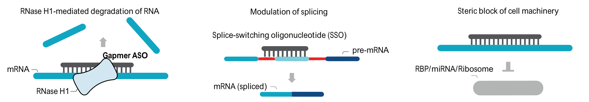

<div align="center">

# MODAL-ASO

**Multi-mechanism Orchestration and Design by an Agentic LLM for ASOs**

Design and evaluate antisense oligonucleotides from a natural-language request.

[Quick start](#quick-start) · [Installation](docs/installation.md) · [Examples](docs/examples.md) · [Outputs](docs/outputs.md)


<picture>
<source media="(max-width: 640px)" srcset="docs/assets/mechanisms-mobile.png">

</picture>

</div>

MODAL-ASO connects transcript selection, candidate design, chemistry, off-target analysis and mechanism-specific predictions. Each run produces ranked candidates and a report with supporting evidence.

| Capability | What it does |
| :--- | :--- |
| **Gapmer design** | RNase H-active candidates, target accessibility and OligoAI predictions. |
| **Splice modulation** | Splice-switching candidates with predicted junction effects. |
| **Regulatory blocking** | Steric candidates targeting RNA regulatory interactions. |
| **Translation inhibition** | Steric candidates at transcript-resolved translation-start regions. |
| **Intron events and cryptic sites** | Reference-bound intron retention/excision hypotheses and localized cryptic splice targets, with collateral splice-site evidence. |
| **Recommended shortlist** | Count-aware selection from the eligible pool, with off-target scope, contextual motif flags, and qualified reference thermodynamics. |
| **ASO evaluation** | Assess supplied sequences, compare candidates and inspect existing results. |

## Quick start

Use **Linux**, **Windows with WSL2**, or **Apple silicon macOS**. Install [uv](https://docs.astral.sh/uv/getting-started/installation/) and the [platform prerequisites](docs/installation.md#prerequisites).

```bash
git clone https://github.com/amonell/MODAL-ASO.git
cd MODAL-ASO
uv sync --frozen --extra splice
source .venv/bin/activate

modal-aso setup --species human --features tools references splice
modal-aso doctor
```

Setup stores downloads outside the repository. Future sessions reuse the same tools, models, genomes and indexes. [Choose a data drive or import existing references →](docs/references.md)

Configure DeepSeek through OpenRouter:

```bash
export ASO_LLM_PROVIDER=openrouter
export OPENROUTER_API_KEY="your-api-key"
export OPENROUTER_MODEL="deepseek/deepseek-v4.1-flash"
export OPENROUTER_REASONING_EFFORT=max
```

Then describe your request:

```bash
modal-aso "Design 10 RNase H-active gapmer ASOs targeting human PCSK9 mRNA."
```

Answer any clarification questions in the terminal. Open the printed **`report.html`** path when the run finishes.

If a design request does not specify a panel size, MODAL-ASO asks after scoring how many distinct ASOs to recommend. Answer with an overall count or `all eligible`. Changing that preference resumes selection and reporting from the computed candidates. The full assessed pool remains in `candidate_assessments.json`; `recommended_shortlist.json`, `.csv`, and `.md` explain the selected molecules.

Each design also exports `design_qualification.json`: versioned mechanism requirements, resolved reference identities, selected and pool counts, physical splice-element coverage, and missing evidence. For a typed isoform conversion, an observed bypass junction can resolve a physical cassette exon despite different exon numbering; conflicting evidence requires clarification. Gapmer exports record each job's actual template, including separate templates in a mixed panel. An exon label that describes an isoform outcome does not restrict gapmer binding to that exon; explicit binding regions retain their own constraints.

No prepared reference-evidence cache is needed. Normal reference setup and live resolution work from a clean installation. Within a run, unchanged steric exports can be reused after verifying input, source and output hashes; changed counts or evidence rebuild the exports from existing scientific results. Large JSON exports are streamed. Gapmer exports retain their OligoAI evaluation path. These computational checks do not establish biological efficacy or exact manuscript reproduction.

Off-target screening defaults to exact, one- and two-substitution searches; an explicit supported budget takes precedence. Counts retain the reference, mismatch budget and hit unit. Incomplete or capped searches cannot establish a clean screen. Published motif flags retain their chemistry and experimental context: for example, [TGC/TCC findings in LNA 3-8-3 gapmers](https://pmc.ncbi.nlm.nih.gov/articles/PMC4005641/) are not universal MOE toxicity rules. Only explicit user sequence exclusions act as hard motif filters.

Tm and ΔG use the [Sugimoto RNA/DNA nearest-neighbor model](https://doi.org/10.1021/bi00035a029) for an unmodified, perfect-match reference duplex at 1 M sodium (default: 37 °C and 500 nM per strand). Modified molecules, including 2′MOE/PS ASOs, receive a clearly labeled reference proxy; the harness does not invent modified-chemistry affinity parameters. These values are not measured binding affinities or efficacy scores. Predicted splice-site changes likewise do not establish intron retention, absence of cryptic products, or protein outcomes.

<details>
<summary><strong>Choose another model or reasoning level</strong></summary>

```bash
export OPENROUTER_MODEL="provider/model"
export OPENROUTER_REASONING_EFFORT=none
```

Choose a model that supports tool calling and your selected reasoning effort. [OpenRouter settings →](docs/llm-providers.md)

</details>

<details>
<summary><strong>Enable OligoAI gapmer scoring</strong></summary>

On Linux with an NVIDIA Ampere or newer GPU:

```bash
modal-aso setup --features oligoai
```

This installs the pinned OligoAI model and its Python environment once. Reports show predictions for supported chemistry, dose and delivery conditions. [Model requirements →](docs/installation.md#models)

</details>

## Your results

| File | Contents |
| :--- | :--- |
| `report.html` | Interactive report, candidate tables and evidence links. |
| `report.md` | Text report. |
| CSV / TSV tables | Candidate sequences, chemistry and computed measurements. |
| GenBank files | Candidate locations in their reference context. |
| `artifacts/` | Structured inputs, calculations and supporting files. |

Keep each run folder together so its report links remain valid. [Output guide →](docs/outputs.md)

## More

[Example requests](docs/examples.md) · [Reference management](docs/references.md) · [Troubleshooting](docs/installation.md#troubleshooting) · [Contributing](CONTRIBUTING.md)

MODAL-ASO is research software. Candidate predictions require experimental validation.

Licensed under [GPL-3.0](LICENSE). See [third-party acknowledgments](THIRD_PARTY_NOTICES.md) and [citation information](CITATION.cff).
