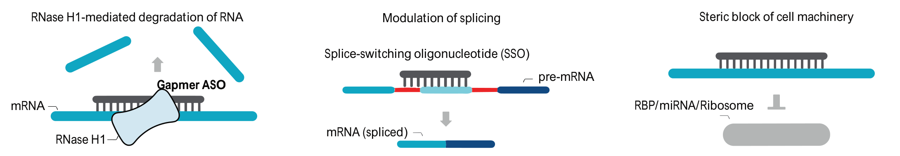

<div align="center">

# MODAL-ASO

**Design and evaluate antisense oligonucleotides from a natural-language request.**

[Quick start](#quick-start) · [Installation](docs/installation.md) · [Examples](docs/examples.md) · [Outputs](docs/outputs.md)


<picture>
<source media="(max-width: 640px)" srcset="docs/assets/mechanisms-mobile.png">

</picture>

</div>

MODAL-ASO connects transcript selection, candidate design, chemistry, off-target analysis and mechanism-specific predictions. Each run produces ranked candidates and a report with supporting evidence.

| Workflow | What it does |
| :--- | :--- |
| **Gapmer design** | RNase H-active candidates, target accessibility and OligoAI predictions. |
| **Splice modulation** | Splice-switching candidates with predicted junction effects. |
| **Regulatory blocking** | Steric candidates targeting RNA regulatory interactions. |
| **ASO evaluation** | Assess supplied sequences, compare candidates and inspect existing results. |

## Quick start

Use **Linux**, **Windows with WSL2**, or **Apple silicon macOS**. Install [uv](https://docs.astral.sh/uv/getting-started/installation/) and the [platform prerequisites](docs/installation.md#prerequisites).

```bash
git clone https://github.com/amonell/MODAL-ASO.git
cd MODAL-ASO
uv sync --frozen --extra splice
source .venv/bin/activate

modal-aso setup --species human --features tools references splice
modal-aso doctor
```

Setup stores downloads outside the repository. Future sessions reuse the same tools, models, genomes and indexes. [Choose a data drive or import existing references →](docs/references.md)

Set your API key:

```bash
export OPENAI_API_KEY="your-api-key"
```

Then describe your request:

```bash
modal-aso "Design 10 RNase H-active gapmer ASOs targeting human PCSK9 mRNA."
```

Answer any clarification questions in the terminal. Open the printed **`report.html`** path when the run finishes.

<details>
<summary><strong>Use OpenRouter or choose another model</strong></summary>

```bash
export ASO_LLM_PROVIDER=openrouter
export OPENROUTER_API_KEY="your-api-key"
export OPENROUTER_MODEL="provider/model"
export OPENROUTER_REASONING_EFFORT=max
```

Choose a model that supports tool calling and your selected reasoning effort. [Provider settings →](docs/llm-providers.md)

</details>

<details>
<summary><strong>Enable OligoAI gapmer scoring</strong></summary>

On Linux with an NVIDIA Ampere or newer GPU:

```bash
modal-aso setup --features oligoai
```

This installs the pinned OligoAI model and its Python environment once. Reports show predictions for supported chemistry, dose and delivery conditions. [Model requirements →](docs/installation.md#models)

</details>

## Your results

| File | Contents |
| :--- | :--- |
| `report.html` | Interactive report, candidate tables and evidence links. |
| `report.md` | Text report. |
| CSV / TSV tables | Candidate sequences, chemistry and computed measurements. |
| GenBank files | Candidate locations in their reference context. |
| `artifacts/` | Structured inputs, calculations and supporting files. |

Keep each run folder together so its report links remain valid. [Output guide →](docs/outputs.md)

## More

[Example requests](docs/examples.md) · [Reference management](docs/references.md) · [Troubleshooting](docs/installation.md#troubleshooting) · [Contributing](CONTRIBUTING.md)

MODAL-ASO is research software. Candidate predictions require experimental validation.

Licensed under [GPL-3.0](LICENSE). See [third-party acknowledgments](THIRD_PARTY_NOTICES.md) and [citation information](CITATION.cff).
