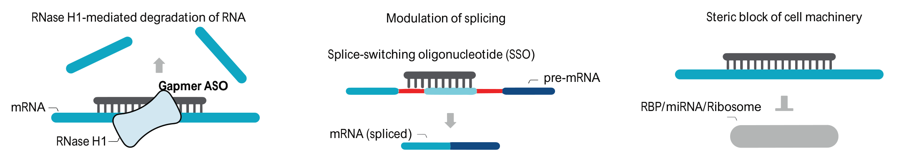

<div align="center">

# MODAL-ASO

**Multi-mechanism Orchestration and Design by an Agentic LLM for ASOs**

Design and evaluate antisense oligonucleotides from a natural-language request.

[Quick start](#quick-start) · [GUI](#optional-browser-gui) · [Installation](docs/installation.md) · [Examples](docs/examples.md) · [Outputs](docs/outputs.md)

[Release 1.0.1](https://github.com/amonell/MODAL-ASO/releases/tag/v1.0.1) · [Changes](CHANGELOG.md) · [Report an issue](https://github.com/amonell/MODAL-ASO/issues/new/choose)


<picture>
<source media="(max-width: 640px)" srcset="docs/assets/mechanisms-mobile.png">

</picture>

</div>

MODAL-ASO connects transcript selection, candidate design, chemistry, off-target analysis and mechanism-specific predictions. Each run produces ranked candidates and a report with supporting evidence.

| Capability | What it does |
| :--- | :--- |
| **Gapmer design** | RNase H-active candidates, target accessibility and OligoAI predictions. |
| **Splice modulation** | Splice-switching candidates with predicted junction effects. |
| **Regulatory blocking** | Steric candidates targeting RNA regulatory interactions. |
| **Translation inhibition** | Steric candidates at transcript-resolved translation-start regions. |
| **Intron events and cryptic sites** | Reference-bound intron retention/excision hypotheses and localized cryptic splice targets, with collateral splice-site evidence. |
| **Recommended shortlist** | Count-aware selection from the eligible pool, with off-target scope, contextual motif flags, and qualified reference thermodynamics. |
| **ASO evaluation** | Assess supplied sequences, compare candidates and inspect existing results. |

## Quick start

Use **Linux**, **Windows with WSL2**, or **Apple silicon macOS**. Install [uv](https://docs.astral.sh/uv/getting-started/installation/) and the [platform prerequisites](docs/installation.md#prerequisites).

```bash
git clone --branch v1.0.1 https://github.com/amonell/MODAL-ASO.git
cd MODAL-ASO
uv sync --frozen --extra splice
source .venv/bin/activate
modal-aso --version

modal-aso setup --species human --features tools references splice
modal-aso doctor
```

Setup stores downloads outside the repository. Future sessions reuse the same tools, models, genomes and indexes. [Choose a data drive or import existing references →](docs/references.md)

MODAL-ASO defaults to DeepSeek v4.1 Flash (`deepseek/deepseek-v4.1-flash-1017`) through OpenRouter. Set your API key:

```bash
export OPENROUTER_API_KEY="your-api-key"
```

Then describe your request:

```bash
modal-aso "Design 10 RNase H-active gapmer ASOs targeting human PCSK9 mRNA."
```

Answer any clarification questions in the terminal. Open the printed **`report.html`** path when the run finishes.

If a design request does not specify a panel size, the reviewer proposes a compact panel based on the saved evidence. You can request an overall count or `all eligible`. Large libraries are reviewed in parallel batches: every eligible molecule enters the nomination pass, finalists receive a detailed comparison, and the selected ASOs receive explanations checked against the full evidence. The terminal shows candidate and batch counts as the review progresses. Requested counts, binding regions, roles and spacing remain enforced, and all eligible candidates remain available to the selector. The full assessed pool stays in `candidate_assessments.json`; `recommended_shortlist.json`, `.csv`, and `.md` explain the selected molecules.

Each design also exports `design_qualification.json`: versioned mechanism requirements, resolved reference identities, selected and pool counts, physical splice-element coverage, and missing evidence. For a typed isoform conversion, an observed bypass junction can resolve a physical cassette exon despite different exon numbering; conflicting evidence requires clarification. Gapmer exports record each job's actual template, including separate templates in a mixed panel. An exon label that describes an isoform outcome does not restrict gapmer binding to that exon; explicit binding regions retain their own constraints.

No prepared reference-evidence cache is needed. Normal reference setup and live resolution work from a clean installation. Within a run, unchanged steric exports can be reused after verifying input, source and output hashes; changed counts or evidence rebuild the exports from existing scientific results. Large JSON exports are streamed. Gapmer exports retain their OligoAI evaluation path. These computational checks do not establish biological efficacy or exact manuscript reproduction.

Off-target screening defaults to exact, one- and two-substitution searches; an explicit supported budget takes precedence. Counts retain the reference, mismatch budget and hit unit. Incomplete or capped searches cannot establish a clean screen. Published motif flags retain their chemistry and experimental context: for example, [TGC/TCC findings in LNA 3-8-3 gapmers](https://pmc.ncbi.nlm.nih.gov/articles/PMC4005641/) are not universal MOE toxicity rules. Only explicit user sequence exclusions act as hard motif filters.

Tm and ΔG use the [Sugimoto RNA/DNA nearest-neighbor model](https://doi.org/10.1021/bi00035a029) for an unmodified, perfect-match reference duplex at 1 M sodium (default: 37 °C and 500 nM per strand). Modified molecules, including 2′MOE/PS ASOs, receive a clearly labeled reference proxy; the harness does not invent modified-chemistry affinity parameters. These values are not measured binding affinities or efficacy scores. Predicted splice-site changes likewise do not establish intron retention, absence of cryptic products, or protein outcomes.

<details>
<summary><strong>Choose another model or reasoning level</strong></summary>

```bash
export OPENROUTER_MODEL="provider/model"
export OPENROUTER_REASONING_EFFORT=none
```

Choose a model that supports tool calling and your selected reasoning effort. Explicit provider and model settings take precedence over the defaults. The CLI prints the selected model at startup. [Provider and model settings →](docs/llm-providers.md)

</details>

<details>
<summary><strong>Enable OligoAI gapmer scoring</strong></summary>

On Linux with an NVIDIA Ampere or newer GPU:

```bash
modal-aso setup --features oligoai
```

This installs the pinned OligoAI model and its Python environment once. Reports show predictions for supported chemistry, dose and delivery conditions. [Model requirements →](docs/installation.md#models)

</details>

## Optional browser GUI

The GUI is an optional browser interface in this repository. There is no separate
application installer or repository to download. CLI-only users can omit the
`gui` extra. Use Linux, Windows with WSL2, or Apple silicon macOS and complete
the [platform prerequisites](docs/installation.md#prerequisites).

### Install the GUI

From your MODAL-ASO repository directory, run:

```bash
uv sync --frozen --extra splice --extra gui
uv run --frozen --extra splice --extra gui modal-aso gui
```

The two occurrences of `gui` serve different purposes: `--extra gui` includes
the optional interface dependencies, while `modal-aso gui` launches the browser
interface. Use the full `uv run` command above each time you start the GUI so
uv keeps the required extras enabled. Press **Ctrl+C** to stop it.

For a fresh clone, first follow [Quick start](#quick-start) to install the
scientific tools and references. Adding the GUI does not replace that setup.
The commands above use the committed `uv.lock`; do not regenerate it to install
the interface.

### Update or reinstall the GUI

Stop the running GUI with **Ctrl+C** in its launch terminal. In the repository
directory, download published source changes and sync the optional dependencies:

```bash
git pull --ff-only
uv sync --frozen --extra splice --extra gui
uv run --frozen --extra splice --extra gui modal-aso gui
```

If the changes are already present in your local checkout, skip `git pull` and
run the two `uv` commands. Sync installs any missing GUI dependencies; deleting
the repository or virtual environment is unnecessary. If Git reports conflicting
local changes, preserve those changes before updating; do not force an overwrite.

Open the local URL printed in the terminal, usually `http://localhost:8501`,
and refresh an existing browser tab after restarting. On Windows, run these
commands inside WSL2 and open the URL in your Windows browser. Stopping the
server ends the current chat session, so save any outputs you need first.

### Configure and use the interface

OpenRouter defaults to `deepseek/deepseek-v4.1-flash-1017`. The compatible model catalog loads after you enter your key. Reasoning effort defaults to the highest supported level advertised for the selected model, and you can choose a lower level. Choose OpenRouter or OpenAI and paste your API key. With OpenRouter, optionally
load the compatible model catalog and select a model and reasoning effort.
Model and reasoning selections set the existing `OPENROUTER_MODEL`
and `OPENROUTER_REASONING_EFFORT` variables inside the analysis worker.
Direct OpenAI uses its existing per-agent CLI configuration; the framework has
no equivalent global OpenAI override, so the GUI provides no global model or
reasoning selector for that provider. Click
**Validate and open chat**. Validation makes a small billable API request to
check authentication, model access and structured tool calling. Errors identify
the affected setting; chat stays closed until validation succeeds.

The OpenRouter catalog requires advertised tools and structured outputs. Effort
options follow its live per-model reasoning metadata. Models without effort
metadata expose only inherited settings.
Catalog support and a successful check do not guarantee every future request
will succeed. Model availability, provider limits and tool installations can
change.

The local server binds to `127.0.0.1`. Keys stay in session memory and are not
written to configuration files. Each analysis runs in its own process using the
existing controller and CLI runtime bootstrap. GUI choices use only existing CLI
environment variables. The GUI does not rewrite prepared model requests, clear
inherited routing settings, or patch SDK serialization. Scientific prompts, tools, ranking and report
generation are unchanged. Chat collects clarification answers; Results embeds
the existing HTML report; Files offers output downloads and Markdown previews.
The controller's existing user-facing CLI commentary appears as assistant
messages in Chat and remains for the session, with a three-dot activity indicator
while work is in progress. Low-level tool-start, tool-completion and model-response
events are hidden by default; enable **Show technical activity** to inspect them.
Internal planner reasoning and raw tool arguments are not displayed.
Files lists each output with its own Download button; Markdown files
also have expandable previews. Native subprocess diagnostics may
still appear in the launch terminal. Closing the server
ends the GUI session; conversation persistence and restart recovery are not yet
provided. On Windows, launch inside WSL2 and open the printed localhost URL in
your Windows browser.

The GUI controller adapter is in `aso_agents/gui/worker.py`. If the controller's
public arguments or callbacks change, update this adapter and its contract tests
rather than adapting the scientific engine to the GUI.

Under **Advanced · timeout and retries**, OpenRouter users can set the existing
`OPENROUTER_TIMEOUT_SECONDS` and `OPENROUTER_MAX_RETRIES` options. Unchecked
controls inherit CLI settings. These are network timeouts and SDK retries, not a
total run deadline. The setup probe uses its own 40-second timeout and no retries,
without changing analysis settings.

Run the GUI regression tests with:

```bash
uv sync --frozen --extra splice --extra dev --extra gui
.venv/bin/python -m pytest tests/test_gui*.py tests/test_llm_provider.py
```

Compatibility metadata follows the [OpenRouter model catalog](https://openrouter.ai/docs/api/api-reference/models/list-all-models-and-their-properties)
and [per-model reasoning options](https://openrouter.ai/docs/guides/best-practices/reasoning-tokens).
Parity tests compare full captured CLI and GUI requests, including prompts,
reasoning settings, schemas, tools and continuation history, using deterministic
replies. Identical configuration follows the same execution path; real LLM replies
can still vary between runs.

The GUI extra constrains Streamlit and Starlette to a tested combination.
Streamlit's gzip middleware is incompatible with newer Starlette internals;
an affected installation can report `Expected ASGI message 'http.response.start',
but got 'http.response.body'` while serving browser files. Stop the GUI,
repeat the frozen GUI install command above, then relaunch it. HTTP middleware
regression tests cover file responses with and without compression headers.

## Output files

| File | Contents |
| :--- | :--- |
| `report.html` | Interactive report, candidate tables and evidence links. |
| `report.md` | Text report. |
| CSV / TSV tables | Candidate sequences, chemistry and computed measurements. |
| GenBank files | Candidate locations in their reference context. |
| `artifacts/` | Structured inputs, calculations and supporting files. |

Keep each run folder together so its report links remain valid. [Output guide →](docs/outputs.md)

## More

[Example requests](docs/examples.md) · [Reference management](docs/references.md) · [Troubleshooting](docs/installation.md#troubleshooting) · [Contributing](CONTRIBUTING.md)

MODAL-ASO is research software. Candidate predictions require experimental validation.

Licensed under [GPL-3.0](LICENSE). See [third-party acknowledgments](THIRD_PARTY_NOTICES.md) and [citation information](CITATION.cff).
